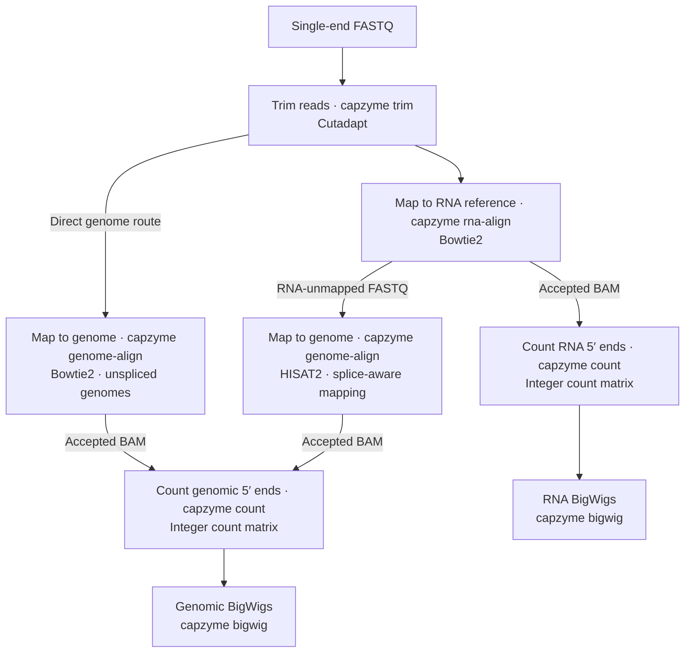

# CapZyme-DAD

**Data Analysis and Display for CapZyme-seq**

Count RNA 5′ ends at single-nucleotide resolution and create tracks for genome browsers.

CapZyme-seq experiments use enzyme treatments to make selected RNA 5′ ends available for sequencing. Comparing treated libraries with controls maps these ends and measures enzyme-dependent recovery, which can provide information about RNA 5′ caps and other terminal structures. CapZyme-DAD processes the sequencing reads to locate RNA 5′ ends at single-nucleotide resolution and compare their counts across libraries.



Choose one genome route per analysis; do not combine the two branches' assignments. The figure shows alternative mapping routes. For an unspliced genome, such as many bacterial genomes, map trimmed reads directly with Bowtie2. For sequential RNA-to-genome analysis, map to the RNA reference first and pass its unmapped reads to HISAT2 for splice-aware genome mapping.

Use the tools individually, starting from FASTQ, BAM or count files, or combine them with the optional Snakemake workflow. Trimming and mapping use established programs; CapZyme-DAD provides 5′-end counting, track generation and checks for connecting the stages.

[Features](#features) · [Installation](#installation) · [Tools](#tools) ·
[Command-line tools](#command-line-tools) · [Worked example](#worked-example) ·
[Software requirements](#software-requirements) ·
[Snakemake workflow](#snakemake-workflow) · [Help and citations](#help-and-citations)

## **Features**

Go from a CapZyme-seq experiment to **count matrices for downstream analysis** and **BigWig tracks for visualization** with the CapZyme-DAD pipeline.

CapZyme-DAD consists of independent tools that can also be used with existing alignments and custom references. Optional Snakemake workflows connect the processing steps, pass data between tools and run the selected analysis across multiple libraries.

## **Installation**

Conda installs CapZyme's supporting programs together in a named environment: a separate collection of software for this analysis. If you do not have Conda, follow the [Miniforge installation instructions](https://github.com/conda-forge/miniforge#install) for your computer first.

Download and unzip the [source files](https://github.com/jeppevinther/capzyme-dad/archive/refs/heads/main.zip), or clone the [repository](https://github.com/jeppevinther/capzyme-dad). Open a terminal in the extracted folder, which contains `README.md`, `environment.yaml` and `pyproject.toml`. In the commands below, replace `/path/to/capzyme-dad` with that folder's actual location; keep quotation marks if its path contains spaces.

```bash
# Move into the folder containing the CapZyme-DAD program and installation files.
cd "/path/to/capzyme-dad"

# Download and install the supporting programs in a new environment named capzyme.
# Strict channel priority uses the package sources in environment.yaml in order.
CONDA_CHANNEL_PRIORITY=strict conda env create --file environment.yaml

# Tell this terminal to use the programs in the capzyme environment.
conda activate capzyme

# Install CapZyme from the current folder using the dependencies just installed.
python -m pip install --no-build-isolation --no-deps .

# Check that the programs needed for the RNA workflow can be found and run.
capzyme workflow doctor
```

Create the environment and install CapZyme once. Whenever you open a new terminal window to use the tools, first run:

```bash
# Select the CapZyme software already installed on your computer.
conda activate capzyme
```

Activation selects the installed software for that terminal; it does not download or reinstall it. You can then run `capzyme` commands from any folder. The recommended environment includes Cutadapt, Bowtie2, HISAT2, SAMtools, BEDTools, pyBigWig and Snakemake, and has been tested on Linux x86-64 and native macOS Apple Silicon.

See the [installation guide](docs/installation.md) for obtaining the source files, checking both genome aligners, and running a small example to confirm the installation. **If DESeq2-normalized BigWigs are needed, a separate R/DESeq2 environment is required.** See [optional R/DESeq2 installation](docs/installation.md).

## **Tools**

The tools below are listed in their typical order of use. Prepare a reference and index once, then reuse them for your libraries. If you already have trimmed reads, alignments or counts, start with the corresponding tool.

| Command | Purpose | Input | Main output | Selected defaults / required choices |
| --- | --- | --- | --- | --- |
| `capzyme collapse` | Optionally group RNA reference sequences sharing a 5′ prefix | RNA FASTA supplied by the user | Representative FASTA and membership table | Prefix length 30; legacy pseudogene exclusion; see reference guide |
| `bowtie2-build` or `hisat2-build` | Build a mapping index with the selected aligner's native program | Prepared FASTA, optionally from `capzyme collapse`; compatible splice annotation for annotated HISAT2 builds | Bowtie2 or HISAT2 index files | Choose the aligner; build before standalone mapping |
| `capzyme index-record` | Check and record an existing index; does not build it | Matching FASTA and index files built by the user or supplied as a prepared reference | Reference/index manifest and sequence dictionary | Choose aligner; keep index-building records |
| `capzyme trim` | Trim reads with Cutadapt | Raw experimental FASTQ and adapter sequence | Trimmed FASTQ and trimming report | Quality 20; minimum length 15; NextSeq threshold 20; review for your protocol |
| `capzyme rna-align` | Map to an RNA reference with Bowtie2 | Trimmed FASTQ from `capzyme trim` or another trimming tool, plus matching FASTA and index | Accepted BAM, all-record BAM, unmapped FASTQ and QC | MAPQ ≥20; no reverse-complement mapping relative to FASTA records |
| `capzyme genome-align` | Map to a genome with HISAT2 or Bowtie2 | Trimmed FASTQ or RNA-unmapped FASTQ from `capzyme rna-align`, plus matching genome FASTA and index | Accepted BAM, all-record BAM, unmapped FASTQ and QC | HISAT2 by default; choose Bowtie2 for unspliced mapping; MAPQ ≥20; no soft clipping; explicit decoy choice |
| `capzyme count` | Count 5′ ends at individual nucleotides | Accepted BAMs from `capzyme rna-align` or `capzyme genome-align`, or existing single-end BAMs, with matching FASTA | Integer count matrix | MAPQ ≥20; both strands; no count threshold; duplicate-marked records retained |
| `capzyme bigwig` | Create browser tracks | Unthresholded matrix from `capzyme count`, or single-end BAMs from the mapping tools or other sources, plus matching FASTA/sizes | One BigWig per sample/selected strand | Both strands; normalization must be chosen |

Each command has help, for example `capzyme trim --help` or `capzyme count --help`. `bowtie2-build` and `hisat2-build` are supplied by those aligners. The [reference-preparation section](#prepare-references) explains index building and the separate role of `capzyme index-record`.

## **Command-line tools**

### Prepare references

A mapping index is a set of lookup files that helps Bowtie2 or HISAT2 find read matches efficiently. Prepare it once for a particular FASTA and aligner, then reuse it across libraries. If you already have a compatible FASTA and index, you can use those files directly. Each BAM, count matrix and browser track retains coordinates relative to that reference, so keep its identity and orientation consistent throughout an analysis.

### Collapse an RNA reference when needed

`capzyme collapse` groups RNA sequences sharing the selected 5′ prefix and retains the longest sequence in each group. The membership table preserves the original sequence labels. Equal-length ties are resolved by input order. This is useful for deliberately grouping RNA references whose 5′ ends cannot be distinguished at the chosen prefix length; it is optional and is not part of direct genome preparation.

#### `capzyme collapse` options

| Option | Meaning |
| --- | --- |
| `--reference FILE` | Input RNA FASTA |
| `--prefix-length N` | Shared 5′ prefix length used for grouping; default 30 |
| `--drop-biotype NAME` | Additional named biotype exclusion; repeat for several choices |
| `--output-dir DIR` | New directory for the prepared reference and membership records |

Output: `collapsed.fa`, `collapsed.tsv` and `methods.json`. The preserved collapse algorithm also excludes descriptions containing pseudogene; review [reference collapsing](docs/tools/reference_collapse.md) before selecting your reference content. Adding viral records to a collapsed RNA reference is a separate explicit preparation step.

### Build and record a mapping index

**Build the index.** For standalone use, run `bowtie2-build` for a Bowtie2 index or `hisat2-build` for a HISAT2 index before mapping. HISAT2 can incorporate compatible splice annotation during preparation. The mapping commands use the resulting index files; they do not build a missing index automatically.

**Check and record the index.** `capzyme index-record` works on an index that already exists. It checks the FASTA's sequence names and lengths against the index and writes file checksums: fingerprints that can later confirm whether the supplied files have changed. It does not create or repair index files. Keep the original reference and index-building records as well.

#### `capzyme index-record` options

| Option | Meaning |
| --- | --- |
| `--reference FILE` | FASTA used for index preparation |
| `--index PREFIX` | Existing index prefix, shared by the aligner's index files |
| `--aligner bowtie2\|hisat2` | Aligner whose index is being checked |
| `--trusted-manifest FILE` | Optional trusted manifest against which to verify identity |
| `--output-dir DIR` | New directory for reference/index records |

Output: `reference_manifest.json`, reference dictionary and command/provenance records. Checking names and lengths alone does not prove which sequences or splice annotations were used to build an old index; retain reliable build records. See [index preparation](docs/tools/index_preparation.md) for copyable building commands and annotation requirements.

**What does Snakemake prepare?** In generated-reference RNA mode, the workflow can collapse the RNA reference, combine the selected records and build its Bowtie2 index. In fixed-reference RNA mode, it checks and reuses the supplied FASTA and index. Genome workflows use an existing genome index prepared separately. These choices belong in the [Snakemake workflow settings](#snakemake-workflow).

### Trim reads

`capzyme trim` uses Cutadapt to remove adapter sequence and trim low-quality read ends before mapping. Reads shorter than the selected minimum length after trimming are discarded. Supply the adapter sequence for your library preparation and review quality settings for your sequencing protocol.

#### `capzyme trim` options

| Option | Meaning |
| --- | --- |
| `--input-file FILE` | Raw single-end FASTQ, optionally compressed |
| `--adapter SEQUENCE` | Adapter sequence to remove; required |
| `--quality N` | Quality-trimming threshold; default 20 |
| `--minimum-length N` | Minimum retained read length after trimming; default 15 |
| `--nextseq-trim N` | Additional two-color G-tail/quality trimming; default 20; zero still enables it |
| `--no-nextseq-trim` | Disable the extra treatment; ordinary quality trimming remains active |
| `--threads N` | CPU threads; default 1 |
| `--output-dir DIR` | New directory for trimmed reads and reports |

For suitable two-color NextSeq/NovaSeq data, choose the additional treatment deliberately. For other chemistries, use `--no-nextseq-trim` (workflow `nextseq_trim: null`); zero does not disable it.

Use the resulting `trimmed.fastq.gz` for either RNA-reference mapping or direct genome mapping. If your reads have already been trimmed appropriately, start with a mapping tool.

Output: `trimmed.fastq.gz`, `cutadapt.json`, `cutadapt.log` and `methods.json`. See [trimming](docs/tools/trimming.md) for an example and the underlying Cutadapt command.

### Map reads

Choose the mapping route to match your reference and analysis:

- **RNA reference:** `capzyme rna-align` uses Bowtie2 against prepared RNA sequences, such as noncoding RNAs and viral reference records. Its default searches only the supplied orientation of each FASTA record; reference orientation must match the intended analysis.
- **Direct genome mapping:** `capzyme genome-align --aligner bowtie2` maps trimmed reads directly to an unspliced genome, for example a bacterial genome. An RNA-reference mapping step is optional.
- **Splice-aware genome mapping:** `capzyme genome-align --aligner hisat2` uses HISAT2 when spliced alignments are needed. It can take the RNA-unmapped FASTQ from a sequential analysis or appropriately trimmed reads directly.

The figure illustrates common choices; the tools do not restrict Bowtie2 to direct mapping or HISAT2 to sequential mapping.

#### `capzyme rna-align` options

| Option | Meaning |
| --- | --- |
| `--input-file FILE` | Trimmed FASTQ from `capzyme trim` or another trimming tool |
| `--reference FILE` | Finished RNA-reference FASTA |
| `--index PREFIX` | Existing Bowtie2 index matching the RNA FASTA |
| `--mapq N` | Minimum mapping quality for accepted alignments; default 20 |
| `--threads N` | CPU threads for mapping |
| `--output-dir DIR` | New directory for RNA alignments and reports |

#### `capzyme genome-align` options

| Option | Meaning |
| --- | --- |
| `--input-file FILE` | Trimmed FASTQ, or RNA-unmapped FASTQ from `capzyme rna-align` |
| `--reference FILE` | Genome FASTA |
| `--index PREFIX` | Existing index matching the genome FASTA and selected aligner |
| `--aligner bowtie2\|hisat2` | Choose Bowtie2 for unspliced mapping or HISAT2 for splice-aware mapping; default HISAT2 |
| `--mapq N` | Minimum mapping quality for accepted alignments; default 20 |
| `--threads N` | CPU threads for mapping |
| `--decoys FILE` or `--no-decoys` | Identify reference records to exclude, or explicitly declare that the reference has none |
| `--output-dir DIR` | New directory for genome alignments and reports |

Decoys are reference sequences included to absorb reads that should not be assigned to the intended genome. Keep them in the matching FASTA/index and identify them explicitly for exclusion. Genome mapping applies the conservative 5′-end acceptance policy, including disabled soft clipping, described in the detailed guide.

Output: `accepted.bam` contains alignments passing the declared filters and is the input for 5′ counting. `alignments.bam` retains all aligner records for inspection; `unmapped.fastq` contains reads the aligner classified as unmapped. QC and provenance document filtering and read accounting. In a sequential analysis, forward only the RNA aligner's `unmapped.fastq` to genome mapping; low-quality mapped rejects are kept separate.

See [RNA alignment](docs/tools/rna_alignment.md) and [genome alignment](docs/tools/genome_alignment.md) for orientation choices, conservative genome CIGAR acceptance and native aligner commands.

### Count 5′ ends

Use the accepted BAMs produced by `capzyme rna-align` or `capzyme genome-align`, or existing single-end BAMs from another mapper. Supply one BAM and sample name for each library, plus the matching FASTA used for mapping.

#### `capzyme count` options

| Option | Meaning |
| --- | --- |
| `--bam FILE` | BAM input; repeat for multiple libraries |
| `--sample-name NAME` | Output sample name; repeat in the same order as BAMs |
| `--reference FILE` | FASTA matching the BAM reference |
| `--mapq N` | Minimum mapping quality, inclusive; default 20 |
| `--strand plus\|minus\|both` | Strands to count; default both |
| `--exclude-duplicates` | Exclude duplicate-marked records; otherwise retain them |
| `--min-total-count N` | Minimum row total; default 0 preserves the unthresholded matrix |
| `--output-dir DIR` | New directory for this tool's results |

Output: `counts.tsv`, its command/provenance log and `methods.json`. The matrix contains `chromosome`, `strand`, `start`, `end`, then ordered sample columns:

```tsv
chromosome	strand	start	end	A	B
chr1	+	100	100	12	4
chr1	-	250	250	0	7
```

Illustrative values. Positions are one-based with `start=end`; values are integer counts after alignment filtering. Keep the unthresholded matrix for statistics and BigWigs. The counter uses aligned 5′ coordinates; see [counting](docs/tools/counting.md) for flag/CIGAR handling and externally produced BAMs.

### Generate BigWigs

Use the unthresholded matrix from `capzyme count` to make tracks from the same counts retained for downstream analysis. Alternatively, provide single-end BAMs from the mapping tools or an existing analysis; the BigWig tool counts their 5′ ends internally.

#### `capzyme bigwig` options

| Option | Meaning |
| --- | --- |
| `--matrix FILE` | Unthresholded integer count matrix |
| `--assert-unthresholded` | Confirm no positions were removed by a count threshold |
| `--reference FILE` or `--chrom-sizes FILE` | Matching reference; supply one |
| `--cohort A B ...` | Samples included in normalization, in the requested order |
| `--normalization MODE` | Choose `raw`, `rpm`, `deseq2`, `controls` or `supplied` |
| `--strand plus\|minus\|both` | Tracks to emit; default both |
| `--output-dir DIR` | New directory for this tool's results |

Output: `tracks/SAMPLE.plus.bw`, `tracks/SAMPLE.minus.bw`, `normalization_factors.tsv` and provenance/command records. DESeq2 modes also save normalization diagnostics.

The installed command also accepts repeated `--bam FILE --sample-name NAME` or
`--bam-manifest FILE`, counting their 5′ ends internally with the shared counter. See [BigWig inputs and normalization options](docs/tools/bigwigs.md) for that route and the extra inputs required by each normalization method. The matrix route shown here reuses the count files intended for downstream analysis.

Load tracks in IGV using the matching reference. Values represent single-base 5′ ends; both strands are nonnegative. Use a common vertical scale when comparing samples within the same normalization method and reference space.

## **Worked example**

Starting with `sample_A.bam`, `sample_B.bam` and their matching `reference.fa`, first produce the count matrix:

```bash
capzyme count \
  --bam /data/sample_A.bam --sample-name A \
  --bam /data/sample_B.bam --sample-name B \
  --reference /data/reference.fa \
  --output-dir /data/analysis/counts
```

Then generate raw-count browser tracks from that matrix:

```bash
capzyme bigwig \
  --matrix /data/analysis/counts/counts.tsv \
  --assert-unthresholded \
  --reference /data/reference.fa \
  --cohort A B \
  --normalization raw \
  --output-dir /data/analysis/bigwigs-raw
```

Replace the paths with yours and choose new output directories. The first command produces the statistical count input; the second produces the browser tracks. See the individual guides for RPM, DESeq2 and other normalization choices.

## **Software requirements**

| Tool | Required software |
| --- | --- |
| Reference collapse | Python |
| Index recording | Python and selected aligner's index inspector |
| Index building | Native Bowtie2 or HISAT2 builder; annotation extractors when applicable |
| Trimming | Cutadapt |
| RNA mapping | Bowtie2 and SAMtools |
| Genome mapping | HISAT2 or Bowtie2, plus SAMtools |
| 5′-end counting | SAMtools and BEDTools |
| BigWigs from matrices | pyBigWig; R/DESeq2 for DESeq2/control normalization |
| BigWigs from BAMs | BigWig dependencies plus SAMtools and BEDTools |
| Optional workflow | Snakemake, configuration reader and the tools selected above |

Tested versions and platform-specific installation instructions belong in the installation guide. Install dependencies for the operations you use.

## **Snakemake workflow**

Snakemake connects the individual tools and passes their outputs to the next step across all libraries in your sample sheet. **Both examples below include raw-count and RPM BigWigs automatically.** You do not need to run the BigWig tool separately.

### Choose an analysis and download its example files

Each analysis uses two editable text files: a **sample sheet** (`.tsv`) listing library IDs and FASTQ files, and an **analysis settings file** (`.yaml`) defining references, tool choices and outputs.

| Analysis | Example sample sheet | Example analysis settings | Starting material |
| --- | --- | --- | --- |
| Sequential RNA-reference → genome mapping | [sequential.samples.tsv](examples/workflows/sequential.samples.tsv) | [sequential.settings.yaml](examples/workflows/sequential.settings.yaml) | Raw single-end FASTQs; trimming is included |
| Direct genome mapping with Bowtie2 | [genome.samples.tsv](examples/workflows/genome.samples.tsv) | [genome.settings.yaml](examples/workflows/genome.settings.yaml) | Already trimmed single-end FASTQs |

Open the example files using the links above, save copies in your own analysis folder, and edit those copies. The examples contain placeholder input paths; they cannot run until you replace them with your files. Include every library you want processed in the sample sheet. Keep the sample sheet and settings file together, outside the CapZyme software folder.

**Sequential mapping: a useful starting point for many eukaryotic experiments.** Reads first map to your prepared RNA reference, which can include noncoding RNAs and viral records. Those sequences receive a defined first assignment rather than competing with genomic copies. Reads the RNA aligner classifies as unmapped then map to the genome with HISAT2, allowing spliced alignments. This gives you separate RNA-reference and genomic count tables and tracks. The choice and content of the RNA reference affect assignment; direct genome mapping remains an alternative. RNA reads that map but fail the acceptance threshold are kept separate rather than forwarded as unmapped reads.

**Direct mapping: a useful starting point for unspliced genomes, including many bacterial genomes.** Bowtie2 maps trimmed reads straight to the genome without an RNA-reference stage. This is simpler when you want positions in one genomic coordinate system and do not need a separate RNA-reference assignment. The current genome-only workflow expects already trimmed reads: use `capzyme trim` first if needed, and put the resulting FASTQ paths in `genome.samples.tsv`.

### Edit the sample sheet and settings

The two sample sheets have the same columns but point to different input stages. For example, the sequential sheet contains:

```tsv
sample_id	fastq
A	/data/reads/A.raw.fastq.gz
B	/data/reads/B.raw.fastq.gz
```

Change the IDs and paths to your libraries; keep IDs unique. In the direct-genome sheet, the paths must point to trimmed FASTQs.

The settings examples are already complete in structure; you do not have to assemble sections from several templates. Review their comments and change:

- **Input and output locations:** the sample-sheet filename, reference FASTAs, existing index prefixes and output directory.
- **Reference identity:** the sequential example reuses an existing RNA FASTA/Bowtie2 index and automatically records observed hashes and checks the index against the FASTA sequences. Expected hashes are optional strict verification; see [reference identity](docs/reference_verification.md). Check whether the index is `.bt2` or `.bt2l`. See [reference preparation](#prepare-references).
- **Trimming:** for the sequential route, supply the adapter sequence for your protocol and review trimming thresholds.
- **Genome choices:** the sequential example uses HISAT2; the direct example uses Bowtie2. Explicitly identify decoys, or declare that your reference contains none.
- **BigWigs and resources:** raw and RPM methods are enabled already. Review threads and memory for your reference and computer. Additional normalization choices are explained below.

Absolute input paths beginning with `/` make file locations unambiguous. Relative paths are interpreted from the analysis working directory, which by default is the folder containing the settings file. The examples therefore locate their sample sheets beside the settings and write to `results-sequential/` or `results-genome/` there.

### Run sequential RNA-to-genome mapping

Suppose you saved the two sequential files in `/data/my-analysis`. Edit their inputs first, then open a terminal and run:

```bash
# Select the CapZyme software installed earlier.
conda activate capzyme

# Check your sample sheet, reference/index settings and required software.
capzyme workflow check --route sequential \
  --config /data/my-analysis/sequential.settings.yaml

# Show the jobs that would run, without processing your libraries.
capzyme workflow preview --route sequential \
  --config /data/my-analysis/sequential.settings.yaml \
  --cores 4 --memory-mb 16384

# Run trimming, RNA mapping, genome mapping, counting and the selected BigWigs.
capzyme workflow run --route sequential \
  --config /data/my-analysis/sequential.settings.yaml \
  --cores 4 --memory-mb 16384
```

Replace `/data/my-analysis` with your folder. `--cores` is the total CPU scheduling budget; `--memory-mb` sets the total `mem_mb` scheduling budget, not an operating-system limit. The values shown are examples to adjust for your reference and machine. Run each command after the preceding check or preview completes successfully.

### Run direct genome mapping

After saving and editing `genome.samples.tsv` and `genome.settings.yaml` in your analysis folder:

```bash
# Select the CapZyme software installed earlier.
conda activate capzyme

# Check the already trimmed FASTQs and genome reference/index settings.
capzyme workflow check --route genome \
  --config /data/my-analysis/genome.settings.yaml

# Inspect planned jobs without processing reads.
capzyme workflow preview --route genome \
  --config /data/my-analysis/genome.settings.yaml \
  --cores 4 --memory-mb 16384

# Run genome mapping, counting and the selected BigWigs.
capzyme workflow run --route genome \
  --config /data/my-analysis/genome.settings.yaml \
  --cores 4 --memory-mb 16384
```

This route does not run trimming or RNA-reference mapping. To resume either analysis, repeat its `run` command; completed compatible steps are reused. See [troubleshooting](docs/results_and_troubleshooting.md) if a step failed or was interrupted.

### Find the results

Paths below are relative to the output directory chosen in your settings:

| Result | Sequential RNA-to-genome | Direct genome |
| --- | --- | --- |
| Integer counts for downstream analysis | `counts/5ends.raw.tsv` and `counts/genome.5ends.raw.tsv` | `counts/genome.5ends.raw.tsv` |
| Raw-count tracks | `bigwigs/rna/raw/tracks/` and `bigwigs/genome/raw/tracks/` | `bigwigs/genome/raw/tracks/` |
| RPM tracks | `bigwigs/rna/rpm/tracks/` and `bigwigs/genome/rpm/tracks/` | `bigwigs/genome/rpm/tracks/` |

Tracks are named `SAMPLE.plus.bw` and `SAMPLE.minus.bw` in these examples. Each normalization directory also contains factors, reference sizes, commands and provenance. Load tracks with the reference used for their mapping: RNA-reference tracks use that custom FASTA; genomic tracks use the matching genome. The matrices remain integer counts after alignment filtering; RPM scaling is applied to the tracks.

### Choose BigWig normalization in the settings

Both example settings already contain the following methods inside each applicable reference space:

```yaml
methods:
  raw: {}  # Original 5′ counts as track values.
  rpm: {}  # Counts per million reads accepted in this RNA or genome mapping stage.
```

RPM means reads per million: each position's count is multiplied by 1,000,000 and divided by the total accepted reads for that sample in the relevant mapping stage. The workflow calculates this total automatically; you do not need to enter it. RNA tracks use RNA-reference accepted reads and genome tracks use genome accepted reads. Each total includes all accepted reference records and both alignment strands, even when only one strand is displayed. Each genomic sample uses the same factor for both strands.

For DESeq2-normalized BigWigs, install the separate R/DESeq2 environment described in the [installation guide](docs/installation.md). Then uncomment the `deseq2` example in the desired settings block and set the actual `Rscript` path:

```yaml
methods:
  raw: {}
  rpm: {}
  deseq2:
    deseq2_type: ratio
    rscript: /path/to/r-environment/bin/Rscript
```

That generates an additional `bigwigs/SPACE/deseq2/tracks/` directory when you run the workflow. Select `ratio` or `poscounts` deliberately; the workflow does not switch estimators if one fails. All configured libraries are used for normalization by default. Use `cohort` to declare a different normalization group and `emit_samples` to choose which of those tracks to write. An empty library cannot support RPM or DESeq2 normalization and must be addressed explicitly rather than silently removed.

Control-based and supplied-factor methods are described in [workflow BigWig settings](docs/workflow_bigwigs.md). DESeq2 here scales browser tracks; downstream statistical testing uses the original integer matrices.

### Try a small artificial example first

To check the installation before using your own data:

```bash
# Generate tiny artificial reads, references and ready-to-run RNA-only settings.
capzyme workflow example --directory /tmp/capzyme-demo --with-bigwigs

# Validate and inspect that example before executing it.
capzyme workflow check --config /tmp/capzyme-demo/config.yaml
capzyme workflow preview --config /tmp/capzyme-demo/config.yaml --cores 4 --memory-mb 16384

# Produce its count matrix and four raw/RPM tracks.
capzyme workflow run --config /tmp/capzyme-demo/config.yaml --cores 4 --memory-mb 16384
```

Choose a new or empty directory. This artificial RNA-only example is separate from the two editable real-analysis templates above. See the [tutorial](docs/getting_started.md) for its expected outputs and the [workflow guide](docs/usage.md) for other routes. Optional standalone settings are described [separately](docs/tool_settings.md).

## **Help and citations**

- [Individual tool guides](docs/toolbox.md)
- [Workflow tutorial](docs/getting_started.md)
- [Troubleshooting](docs/results_and_troubleshooting.md)
- [Software and citations](docs/software_and_citations.md)
- [License](LICENSE)

CapZyme-DAD uses Cutadapt, Bowtie2, HISAT2, SAMtools, BEDTools, pyBigWig and, for selected normalization modes, DESeq2. Please cite the software used in your analysis. Report issues with the command, software versions and relevant error message, removing private paths and sensitive metadata.
